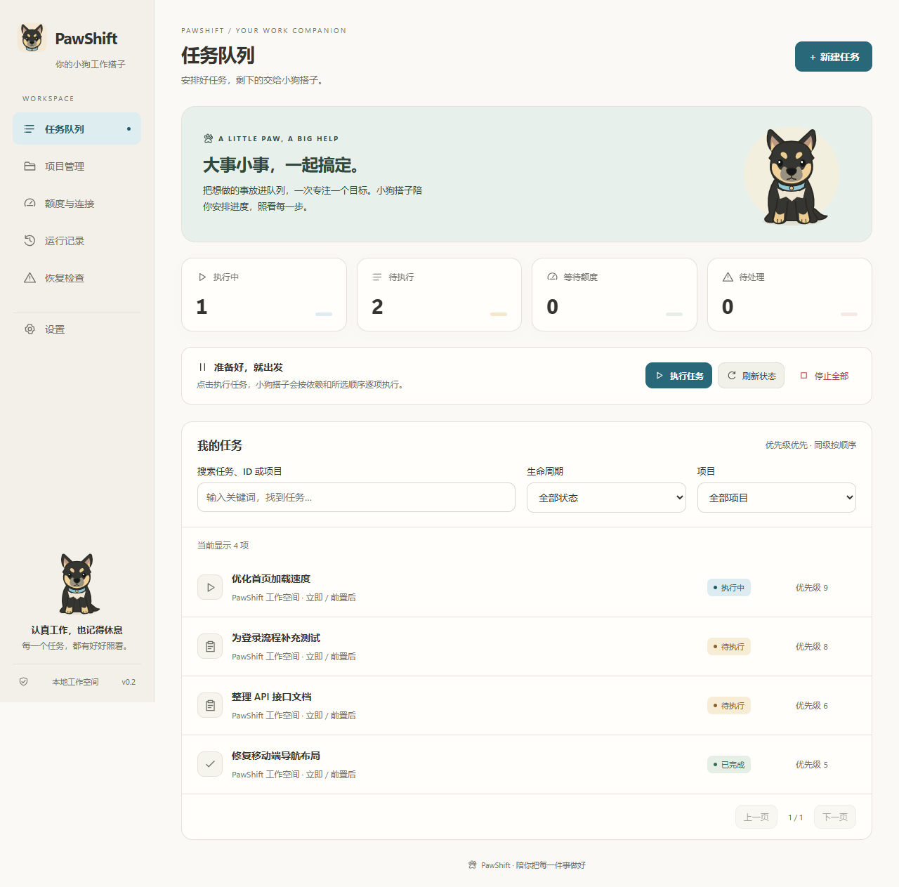

# PawShift

**English** | [简体中文](README.zh-CN.md)

A Windows desktop task manager for Codex with multi-project queues, automated scheduling, task dependencies, pause and resume, and file-based validation.

Connect your local projects, create tasks, and click **Run Tasks** to let the local Codex agent read or modify project files. Once a task succeeds, PawShift automatically starts the next task whose dependency, scheduling, and usage-limit conditions are met.

Current version: **0.3.3** · Windows x64 · Noncommercial license



## Features

- Manage multiple local projects and run tasks in queue order or by priority.
- Configure task dependencies, scheduled start times, file validation paths, and required file contents.
- Handle permission requests in the desktop app and review agent output, tool activity, and validation results.
- Pause scheduling, confirm that execution has stopped, and resume tasks in their original sessions.
- Store tasks locally in SQLite, with backup import, diagnostic export, and theme settings.

## Requirements

- Windows x64, .NET Framework 4.6.2+, and the Evergreen WebView2 Runtime.
- A local Codex execution component, ChatGPT sign-in, and the Windows execution sandbox.
- Node.js 24+ and npm for building from source. Packaged builds include the Node.js runtime.

PawShift automatically looks for the native `codex.exe` bundled with an installed Codex extension for VS Code. You can also select the executable in Settings or specify it with `PAWSHIFT_CODEX_PATH`. On first use, open Settings to check the connection, sign in, and initialize the sandbox.

## Installation and Usage

If a release includes `PawShift-0.3.3-WebView2-x64.zip`, download it, extract the entire archive, and run `PawShift.exe`. Keep all files in the extracted directory together. Exit the previous version before upgrading.

To build and run from source:

```powershell
npm ci
npm run package:dir
npm start
```

After building, you can also use `启动PawShift.cmd` in the project root. GitHub's automatically generated Source code ZIP must be built before use.

The current desktop interface is in Chinese. The steps below use English translations of its labels.

1. Open **Project Management** and connect a local project.
2. Create a task, enter its objective and any validation conditions, review its permissions, and save it to the queue.
3. Click **Run Tasks**. If the project has not been authorized, confirm access first.
4. Review output, tool activity, and file validation results in the task details. For additional permissions, choose **Allow Once** or **Deny Once**.
5. After the current task succeeds, the queue automatically starts the next eligible task.

Scheduling starts only after you click Run Tasks each time you open the app. Task data is stored in `%APPDATA%\PawShift`, with support for existing databases.

## Pausing, Permissions, and Validation

Pausing scheduling stops further dispatch and requests an interruption of the active agent. PawShift shows the task as paused only after confirming that the turn has ended and its tools have stopped. **Resume Execution** prioritizes that task and starts a new turn in its original session. Existing file changes are preserved. If interruption is unconfirmed or the app exits unexpectedly, the execution lock remains in place; use **Check Pause Status** or **Recovery Check** to reconcile it. Other tasks paused individually are not resumed in bulk.

Read-only tasks use a read-only sandbox. Project modification tasks use a sandbox with write access to the entire project and require `.` as the allowed path. Configuring narrower directories does not replace the system sandbox. Additional approvals apply only to a single operation in the corresponding active turn.

After an agent turn ends normally, PawShift checks the configured file paths, contents, and file hashes. If file validation fails, the task is marked as failed and dependent tasks remain blocked. Text-based completion conditions are sent to the agent and should be reviewed alongside its output. Without file checks, **Completed** means that the agent's task turn ended normally.

## Development and Verification

```powershell
npm ci
npm run format:check
npm test
npm run package:dir
npm run verify:release
```

| Command                  | Purpose                                                                                                  |
| ------------------------ | -------------------------------------------------------------------------------------------------------- |
| `npm run build`          | Clean build output, compile the backend, and copy UI assets                                              |
| `npm run format`         | Format source files and documentation                                                                    |
| `npm run format:check`   | Check formatting without changing files                                                                  |
| `npm test`               | Run scheduler, database, execution, UI, and native argument tests without model requests                 |
| `npm run test:desktop`   | Package and test the actual WebView2 window; requires an interactive desktop and makes no model requests |
| `npm run test:agent`     | Run real agent file tasks in an isolated directory; consumes account usage                               |
| `npm run test:pause`     | Verify pause and resume through the actual desktop app; consumes account usage                           |
| `npm run test:resume`    | Verify session recovery for legacy paused tasks; consumes account usage                                  |
| `npm run package:dir`    | Generate the current Windows application and distribution ZIP                                            |
| `npm run verify:release` | Compare the current build with packaged files and check license files                                    |
| `npm run probe`          | After building, inspect the local agent, account, usage limits, and sandbox without model requests       |
| `npm run icons`          | Export application icons from the UI vector artwork                                                      |
| `npm run archive`        | Create a local source and application archive with a file manifest and SHA-256 checksums                 |

Release output is written to `release-webview2/PawShift-0.3.3/` and `release-webview2/PawShift-0.3.3-WebView2-x64.zip`. On pushes to GitHub, CI checks formatting, runs the standard tests, builds the application, and verifies the release files.

## Project Structure

```text
.github/workflows/     GitHub Actions checks
src/agent/             Codex discovery, communication, and protocol types
src/application/       Desktop commands and execution controller
src/domain/            Task, project, and execution models
src/tasks/             Scheduling, dependencies, stopping, recovery, and file validation
src/storage/           SQLite transactions and persistence
src/legacy/            Compatibility for recovering legacy manual tasks
src/webview-backend.ts Communication entry point between the native window and backend
native/                WebView2 window, system tray, and native dialogs
ui/                    UI source, themes, icons, and design previews
scripts/               Build, launch, test, and archive tools
test/                  Automated tests
docs/                  Architecture, maintenance, and publishing documentation
```

Source files and build artifacts are managed separately. Dependencies, release directories, backups, personal data, and local verification reports are excluded from the repository. Legacy recovery modules are still referenced by compatibility paths.

## Documentation and License

PawShift is source-available under the **PolyForm Noncommercial License 1.0.0**. Use, modification, and distribution are permitted for purposes allowed by the license. Commercial use requires separate permission from the rights holders. See [LICENSE](LICENSE) and retain [NOTICE](NOTICE) when redistributing. Third-party components remain subject to their respective licenses.

The linked development documents are currently in Chinese.

- [Code Map](docs/CODEMAP.md)
- [Documentation Index](docs/README.MD)
- [Build and Maintenance Scripts](scripts/README.MD)
- [Contributing](CONTRIBUTING.md)
- [Publishing to GitHub](docs/PUBLISHING.md)
- [Licensing Notes](docs/LICENSING.md)
- [PolyForm Noncommercial License](LICENSE)

PawShift is an independent project and is not an official OpenAI product. Agent capabilities and execution results are determined by the protocol events and terminal states reported by the local Codex component.
