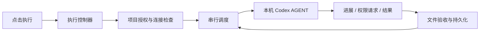

# PawShift 0.3 重构与验收

## 核心变化

默认执行方式统一为本机 Codex AGENT。WebView2 是唯一桌面入口，`ui/` 继续作为独立的界面目录，配色、布局、标识与小狗素材保留。界面行为接入新的执行回执与结果展示，设置中移除互相冲突的手动执行平台选项。

### 已修复的问题

- 未授权项目原先只显示「操作已受理」，任务实际没有启动。现在点击执行会列出需授权的项目；拒绝授权时明确显示任务未启动。
- 执行回执区分已启动、运行中、等待条件、无任务、阻塞和快速完成。运行中的重复点击不会重复派发；暂停调度后可通过执行按钮继续队列。
- 原先自动任务隐藏 AGENT 回复，现在单独保存有长度上限的输出，并显示工具进展与最终结果。诊断导出不包含回复正文。
- 原先自动模式只检查轮次结束，现在还检查任务配置的文件路径与内容。文件验收失败不放行后继依赖。
- 默认安装与空闲旧安装统一使用 AGENT。旧手动任务的恢复代码移入 `src/legacy/`，用于兼容已有未结束执行。
- 删除硬编码的两个完整 CLI 版本白名单，使用最低版本检查与实际通信、账户、沙箱能力检查；模型由执行端的默认模型提供。
- 修复启动回执丢失晚于终态通知时可能重新加锁的问题，避免复活已经完成的执行。
- 排队任务的等待原因没有变化时不重复修改版本，减少编辑时无意义的版本冲突。
- 清理编译目录后再构建，打包递归复制新的模块目录，防止残留的旧后端被误用。

## 模块职责

| 目录              | 职责                                                 |
| ----------------- | ---------------------------------------------------- |
| `src/agent`       | 发现执行组件、JSONL 通信、账户与额度、沙箱、授权响应 |
| `src/application` | 桌面命令与单一点击执行流程                           |
| `src/domain`      | 任务、项目、执行记录和输入约束                       |
| `src/tasks`       | 串行队列、依赖、计划时间、中断、恢复和文件验收       |
| `src/storage`     | SQLite 事务、锁、命令去重与持久化                    |
| `src/legacy`      | 旧手动任务兼容与恢复                                 |
| `native`          | WebView2 窗口、系统托盘、本地授权对话框              |
| `ui`              | 独立界面与品牌资源                                   |

## 验证证据

- 49 项自动测试通过，包括真实状态回执、并发点击、拒绝授权、文件验收失败、自动接续、断连保锁和终态先于启动回执等回归测试。
- `agent-check.json`：调用真实 AGENT 连续完成两个有依赖的文件任务，实际创建 `agent-result.txt` 与 `verification.txt`，核对内容和哈希；确认第二项晚于第一项完成后才开始。
- `agent-desktop-check.json`：从打包后的实际 WebView2 窗口创建任务并点击执行，真实 AGENT 创建 `button-result.txt`，通过文件验收，任务详情显示输出，重启后任务、输出和主题仍保留。
- `screenshots/agent-desktop-result.png`：实际桌面验证的任务结果截图。
- `webview-check.json`：桌面窗口、设置、任务持久化与最小化恢复检查。
- `npm run verify:release`：确认发布后端、界面与图标与当前构建一致。

所有验证使用隔离目录，未对用户的现有排队任务点击执行。真实验证共使用三个 AGENT 任务轮次；普通单元测试和普通桌面检查不发送模型任务。

文件验收只证明配置的文件存在且满足包含文本要求。无文件验收时，正常完成表示 AGENT 轮次正常结束，不代表任意业务目标已经独立验证。

## 清理与保留

- 删除两个 Electron 源码入口、旧 Electron 构建/启动/检查脚本及重复启动文件。
- 卸载 Electron 和 electron-builder，移除 277 个依赖包。
- 原先 1054 个完整生成协议文件退出活动源码，改为只维护实际使用的协议类型。
- 旧发布包、缓存、旧测试目录与旧验证报告退出活动目录，记录见 `cleanup-report.json`。
- 自动审批拒绝旧目录递归删除，原因只返回 `blocked by policy`。为保持可恢复性，旧目录暂移动到 `backups/retired/`，未声称已释放这些目录所占磁盘空间。
- 重构前源码快照位于 `backups/source-before-refactor-20261016.zip`。
- `requirements-source.txt` 是历史规格，用于参考；当前实现与使用方式以根目录 README 为准。
